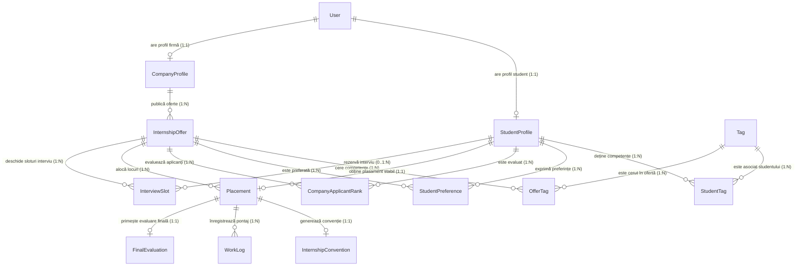

# Contracte de Date și Arhitectură (Data Models & Contracts)

Acest document descrie schema bazei de date, taxonomiile și contractele de securitate/date pentru **P14 - Portal de Practică**.

## 1. Tabele Principale

| Tabel Prisma | Tabel BD (PostgreSQL) | Rol / Descriere | Constrângeri cheie |
|---|---|---|---|
| `User` | `users` | Utilizatori autentificabili și roluri sistem | `email` UNIQUE, Enum `UserRole` (STUDENT, COMPANY_TUTOR, COORDINATOR, ADMIN) |
| `StudentProfile` | `student_profiles` | Profil academic, social bio și profesional student | `userId` UNIQUE (1:1 cu User), `cvUrl`, `githubUrl`, `linkedinUrl` |
| `CompanyProfile` | `company_profiles` | Profil companie parteneră | `userId` UNIQUE (1:1 cu User), `cuiCif` UNIQUE |
| `Tag` | `tags` | Taxonomie competențe (predefinite pe domenii Inginerie + custom) | `name` UNIQUE, Enum `EngineeringDomain`, `isPredefined` |
| `StudentTag` | `student_tags` | Asociere N:M student - tag cu nivel de competență | UNIQUE(`studentId`, `tagId`), `proficiencyLevel` (BEGINNER, INTERMEDIATE, ADVANCED) |
| `OfferTag` | `offer_tags` | Asociere N:M ofertă - tag cu obligativitate | UNIQUE(`offerId`, `tagId`), `isRequired`, `weight` |
| `InternshipOffer` | `internship_offers` | Oferte de practică propuse de companii | FK `companyId`, `slotsTotal`, `slotsAvailable`, `status` |
| `StudentPreference` | `student_preferences` | Lista ordonată de preferințe ale studentului | UNIQUE(`studentId`, `offerId`), UNIQUE(`studentId`, `rank`) |
| `CompanyApplicantRank` | `company_applicant_ranks` | Clasamentul aplicanților stabilit de firmă | UNIQUE(`offerId`, `studentId`), UNIQUE(`offerId`, `rank`), `status` |
| `Placement` | `placements` | Rezultatul stabil al algoritmului de matching | `studentId` UNIQUE (max 1 loc/student), FK `offerId`, status |
| `InternshipConvention` | `internship_conventions` | Convenții de practică generate ca PDF | `placementId` UNIQUE, `conventionNumber` UNIQUE, `prefilledData` (JSONB) |
| `WorkLog` | `work_logs` | Jurnal / pontaj săptămânal ore de practică | FK `placementId`, `date`, `hoursWorked`, `status`, validare tutore |
| `InterviewSlot` | `interview_slots` | Programare sloturi de interviu companie-student | FK `offerId`, FK opțional `studentId`, `isBooked` |
| `FinalEvaluation` | `final_evaluations` | Fișa de evaluare finală a stagiului | `placementId` UNIQUE, `grade`, `feedback`, `competenciesAcquired` |

## 2. Diagrame de Relații (ERD)



## 3. Domeniile Facultății de Inginerie (Taxonomie Tag-uri)

Enum `EngineeringDomain`:
- `COMPUTER_SCIENCE_IT`: Calculatoare și Tehnologia Informației (ex: React, Next.js, Node.js, Python, PostgreSQL, Docker, AI/ML, CyberSec)
- `ELECTRONICS_TELECOM`: Inginerie Electronică și Telecomunicații (ex: Embedded C, Arduino, ESP32, PCB Design, Telecom, IoT)
- `ROBOTICS_MECHATRONICS`: Mecatronică și Robotică (ex: CAD/SolidWorks, PLC Siemens, ROS, Automatizări, Pneumatică)
- `INDUSTRIAL_MANAGEMENT`: Inginerie Industrială / Tehnologică (ex: Lean Manufacturing, Six Sigma, ERP, Calitate, Logistică)
- `GENERAL_ENGINEERING`: Discipline inginerești generale (ex: Matematică aplicată, Fizică, Algoritmi, Management de proiect)

Tag-urile pot fi marcate ca:
- `isPredefined = true`: Tag-uri standard din nomenclatorul facultății.
- `isPredefined = false`: Custom tags adăugate de studenți sau firme.

## 4. Contractul de Confidențialitate (GDPR Privacy Gate)

**Regulă de securitate strictă**: *CV-ul detaliat (`cvUrl`) și datele de contact directe (telefon) ale unui student sunt accesibile reprezentanților companiei **EXCLUSIV DACĂ** studentul a adăugat cel puțin o ofertă a acelei companii în preferințele sale (`StudentPreference`). Dacă studentul nu a aplicat / nu a inclus oferta în preferințe, CV-ul și datele de contact sunt strict blocate și anonimizate.*

Interfață de verificare (în `src/lib/privacy.ts`):
```typescript
export async function canCompanyAccessStudentCv(
  companyProfileId: string,
  studentId: string,
  targetOfferId?: string
): Promise<boolean> {
  // 1. Verifică dacă există cel puțin o înregistrare în StudentPreference
  //    prin care studentul a selectat o ofertă deținută de această companie.
  // 2. Returnează true doar dacă există o preferință activă exprimată de student.
}

export function sanitizeStudentProfileForCompany<T>(
  studentProfile: T,
  canAccessDetails: boolean
): T {
  // Maschează cvUrl și phone cu null când canAccessDetails este false
}
```

Endpoint descărcare securizată: `GET /api/cv/[studentId]` (returnează HTTP 403 Forbidden dacă Privacy Gate nu este îndeplinit).

## 5. Motorul de Recomandare & Scor de Compatibilitate

Scorul de compatibilitate $Score \in [0, 100]\%$ este calculat bidirecțional:
- Pentru student: indică relevanța fiecărei oferte disponibile în feed.
- Pentru companie: sugerează candidați potriviți pentru pozițiile deschise.

Calcul:
$$Score = \left( \frac{\sum_{t \in T_{req} \cap T_{stud}} w(t)}{\sum_{t \in T_{req}} w(t)} \times 70\% \right) + \left( \frac{\sum_{t \in T_{opt} \cap T_{stud}} w(t)}{\sum_{t \in T_{opt}} w(t)} \times 20\% \right) + \left( DomainMatch \times 10\% \right)$$

Unde:
- $T_{req}$ sunt tag-urile obligatorii ale ofertei (`isRequired: true`).
- $T_{opt}$ sunt tag-urile opționale (`isRequired: false`).
- $T_{stud}$ sunt tag-urile din profilul studentului (ponderate opțional după nivelul de competență).
- $DomainMatch$ este $1.0$ dacă domeniul de studiu corespunde categoriei ofertei, altfel $0.0$.

## 6. Contracte Server Actions - Modul Firmă & Interviuri (Partea 1B)

### 6.1 Gestiune Profil Companie (`src/app/actions/company.ts`)
- `updateCompanyProfile(data)`: validare câmpuri obligatorii, unicitate CUI/CIF, salvare date juridice și date contact tutore.

### 6.2 Gestiune Oferte de Practică & Competențe
- `upsertInternshipOffer(data)`: creare sau editare ofertă, sincronizare atomică N:M `OfferTag` (tagId, isRequired, weight).
- `toggleOfferStatus(offerId)`: comutare status între `ACTIVE` și `CLOSED`.
- `deleteOffer(offerId)`: ștergere ofertă nealocată.

### 6.3 Clasament Aplicanți Gale-Shapley (`CompanyApplicantRank`)
- Constrângere DB: `@@unique([offerId, rank])` și `@@unique([offerId, studentId])`.
- `rankApplicant(offerId, studentId)`: adăugare candidat la finalul clasamentului (`rank = max + 1`).
- `reorderCompanyApplicantRanks(offerId, orderedRankIds)`: reordonare tranzacțională în 2 pași cu ranguri negative temporare pentru prevenirea coliziunilor de cheie unică.
- `removeCompanyApplicantRank(rankId)`: ștergere și compactare 1..N.

### 6.4 Programare & Rezervare Interviuri (`InterviewSlot`)
- `createInterviewSlot(offerId, startTime, endTime, meetingLink)`: creare interval orar de interviu de către tutore.
- `deleteInterviewSlot(slotId)`: ștergere slot.
- `bookInterviewSlot(slotId)` (`src/app/actions/student.ts`): rezervare slot de către un student care are oferta în preferințe.
- `cancelInterviewBooking(slotId)`: eliberare slot.

## 7. Contracte Server Actions - Modul Student (`src/app/actions/student.ts`)

### 7.1 Profil Academic & Social
- `updateStudentProfile(data)`: Salvare headline, bio, telefon, link-uri GitHub, LinkedIn, portofoliu și selecție specializare ULBS.
- `updateStudentTags(tags)`: Sincronizare N:M în `student_tags` cu nivel de competență (BEGINNER, INTERMEDIATE, ADVANCED).

### 7.2 Gestiune CV
- `uploadCvFile(formData)`: Încărcare fișier PDF (max 10MB), stocare securizată pe disc și înregistrare `cvUrl`.

### 7.3 Preferințe Ordonate Gale-Shapley (`StudentPreference`)
- Constrângere DB: `@@unique([studentId, offerId])` și `@@unique([studentId, rank])`.
- `addStudentPreference(offerId)`: Adăugare ofertă în preferințe la rangul `max + 1`.
- `reorderStudentPreferences(orderedPreferenceIds)`: Reordonare tranzacțională în 2 pași cu ranguri negative temporare pentru prevenirea coliziunilor de cheie unică.
- `removeStudentPreference(preferenceId)`: Ștergere și compactare 1..N a rangurilor rămase.

### 7.4 Rezervare Interviuri
- `bookInterviewSlot(slotId)`: Rezervare slot liber de către un student care a inclus oferta în preferințe.
- `cancelInterviewBooking(slotId)`: Anulare rezervare proprie.

## 8. Guvernanță & Skill-uri de Lucru (`.agents/skills/`)
- `/plan` ([.agents/skills/plan/SKILL.md](../../.agents/skills/plan/SKILL.md)): Ghid de cercetare și elaborare a planului tehnic de implementare înaintea modificării de cod, cu respectarea strictă a regulilor din `AGENTS.md`.
- `/build` ([.agents/skills/build/SKILL.md](../../.agents/skills/build/SKILL.md)): Ghid de execuție a planurilor aprobate, dezvoltare modulară, rulare teste automate (`privacy.test.ts`, `matching.test.ts`), linting registru (`ledger-lint.py`) și verificare build Next.js.

